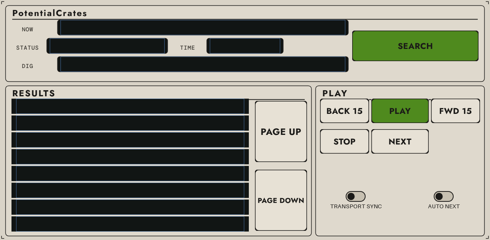
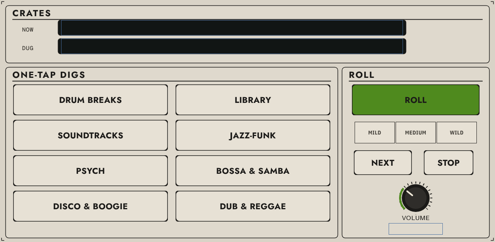

# PotentialCrates

**Dig for records, one tap at a time.** Tap a crate, Drum Breaks or Library or Bossa & Samba, or tap **ROLL**. PotentialCrates finds records on Discogs and streams one into your MPC track, ready to sample.



*Instrument plugin · MPC OS 3.x · Gen1 and Gen2 · v1.1.0 · needs a network connection*

Free and open source (MIT), made by **PotentialBreaks**. It's part of the **PotentialSuite**, with the same three looks and LOOK switch as the rest of the suite.

PotentialCrates is a fork of **[Crate Digger](https://github.com/sd88me/mpc-vst-cratedigger)** by sd88me. It uses Crate Digger's streaming engine, which is built on Charles Vestal's [schwung-webstream](https://github.com/charlesvestal/schwung-webstream). Crate Digger's full history is kept in this repo. Thanks to both.

**[Download the latest release](../../releases/latest)** · [Ideas and bugs](../../issues/new/choose)

## What it does

- **CRATES:** eight one-tap digs. Each picks one of a few real Discogs genre, style and decade combinations, searches, and plays the first result.

  | Crate | Digs in |
  |---|---|
  | **DRUM BREAKS** | Funk, Soul, Jazz-Funk, Boogaloo and Afrobeat, 60s and 70s |
  | **LIBRARY** | library records across Stage & Screen, Jazz and Electronic, 60s to 80s |
  | **SOUNDTRACKS** | Soundtrack and Score, 60s to 80s |
  | **JAZZ-FUNK** | Jazz-Funk, Soul-Jazz and Fusion |
  | **PSYCH** | Psychedelic Rock, Krautrock, psychedelic Soul |
  | **BOSSA & SAMBA** | Bossanova, Samba, MPB, Bossa Nova jazz |
  | **DISCO & BOOGIE** | Disco and Boogie, 70s and 80s |
  | **DUB & REGGAE** | Dub, Roots Reggae, Rocksteady |

- **SEARCH** (top right of the DIG page) digs Discogs with your filters. Leave them all on ANY for anything at all.
- **ROLL** (on the FILTERS and CRATES pages) picks the filters for you, searches and plays the result. **MILD**, **MEDIUM** or **WILD** next to it sets how far it goes:
  - **MILD** stays in the genre you're in (or a digger's favourite), picks a style of it, 60s or 70s.
  - **MEDIUM** picks a digger's genre, any of its styles, 50s to 90s.
  - **WILD** picks any genre, style and decade, and sometimes a country too.
- **If a dig finds nothing**, it digs again with new picks, up to 3 times, so one tap almost always ends in music.
- **AUTO NEXT** (on by default) moves to the next result when a track ends or won't play. **NEXT** skips by hand.
- **FILTERS** is Crate Digger's dig: genre, style, decade, region and country with arrows, then **SEARCH**. **CLEAR FILTERS** sets them all back to ANY. **SOURCE: CHANNEL** digs random uploads from YouTube channels you list (see below).
- **RESULTS** lists 8 a page. Tap one to play it. **PAGE UP** and **PAGE DOWN** move through the pages.
- **PLAY**, **STOP**, **BACK 15** and **FWD 15** are the transport.
- **TRANSPORT SYNC**: a track loads and waits, silent, until you press Play on the MPC, and the MPC's Stop pauses it. This is for resampling in time.
- **The status line says why** a track won't play: private video, removed, region blocked, rate limited, no network.
- **LOOK** (on the SETTINGS page) switches between **Print Plate**, **Night Rack** and **Colour Block**. A new look shows the next time the plugin loads.
- Your project remembers the filters, source, ROLL setting, SYNC, AUTO NEXT and volume.



**MANUAL page:** the manual is on the MPC's screen too. Tap **MANUAL**, then the page buttons along the top. The full [PotentialSuite manual](https://github.com/PotentialBreakfast/potential-plugins/blob/main/MANUAL.md) covers every plugin, the FX chains and a developer reference.

## Install

PotentialCrates carries its own yt-dlp, Python and ffmpeg (the engine), so the download is big: about 70 MB for a Gen1 MPC and 90 MB for a Gen2.

- **With MPC TOOLS:** in the Plugins tab, tap **UPDATE** on PotentialCrates (or **+ ADD A PLUGIN** and paste this repo's address).
- **With the Open MPC installer or Plugin Manager:** use the zip for your MPC: `-mpc-armv7.zip` for a Gen1 (MPC One, Live, Live II, X, Key, Force) or `-mpc-aarch64.zip` for a Gen2 (Live III and other 64-bit units).
- **By hand (MPC OS 3.10.1+, Gen1):** unzip `-mpc-sdk.zip` and copy the folder `PotentialBreaks - VST - PotentialCrates` into `VST2 Plugins` at the top of a drive the MPC can see.

Then turn on **Preferences > Enhancements > VST2 Support**, restart the MPC and add **PotentialCrates** from External VST Plugins.

The first time it loads it gets the engine ready, which takes a moment. If the engine lost its "executable" marks (a zip unpacked on Windows), it puts them back. On a drive that can't run programs (an exFAT SD card or USB stick), it copies the engine to the MPC's internal drive once, as Crate Digger 2 does.

It installs next to Crate Digger, not over it: it has its own name, maker and plugin ID.

### Channels (optional)

To dig random uploads from YouTube channels or playlists, make a `channels.txt` in the plugin folder, one per line: a channel link, an `@handle`, a `UC...` ID or a playlist link, then `|` and a name if you like. `Content/channels.example.txt` shows the format. Set **SOURCE** to **CHANNEL** and pick one with the arrows.

### Discogs token (optional, recommended)

It works without one (Discogs allows 25 requests a minute). A free personal access token from [discogs.com/settings/developers](https://www.discogs.com/settings/developers) raises that to 60. Put it in `/data/UserData/schwung/config/webstream_providers.json` on the MPC:

```json
{ "providers": { "cratedig": { "token": "YOUR_DISCOGS_PERSONAL_TOKEN" } } }
```

## Good to know

- It's a browser and player, not a synth: no MIDI notes in or out.
- Playback depends on yt-dlp working out the stream live on the MPC. YouTube changes things from time to time, and a result can be unavailable in your region. **AUTO NEXT** skips those.
- Use it within Discogs' and YouTube's terms. PotentialCrates isn't affiliated with Akai Professional, Discogs or YouTube.
- Logs: the engine writes `/tmp/webstream-runtime.log` on the MPC.

## How it's built

`src/crates.c` is the plugin: the PotentialSuite front end (pages, CRATES, ROLL, AUTO NEXT, the LOOK switch) on the [Open MPC kit](https://github.com/open-mpc/mpc-vst-plugins)'s VST2 wrapper. `src/core/` is Crate Digger's streaming core, unchanged apart from one fallback for MPC OS's older glibc. `tools/fetch_engine.sh` takes the engine bundle from Crate Digger 2.0.0's release and checks it against pinned checksums. The release workflow (`.github/workflows/release.yml`) builds, tests and packages everything. See [BUILD.md](BUILD.md).

## Credits and licence

MIT, see `LICENSE`. Crate Digger is by sd88me and its contributors. The streaming core is by Charles Vestal (`UPSTREAM_LICENSE.txt`, `UPSTREAM_THIRD_PARTY_NOTICES.md`). The engine bundle's programs have their own licences (yt-dlp: Unlicense; ffmpeg: GPL-3.0; Python: PSF), listed in [THIRD_PARTY.md](THIRD_PARTY.md) and shipped in `Content/engine/LICENSES`.
